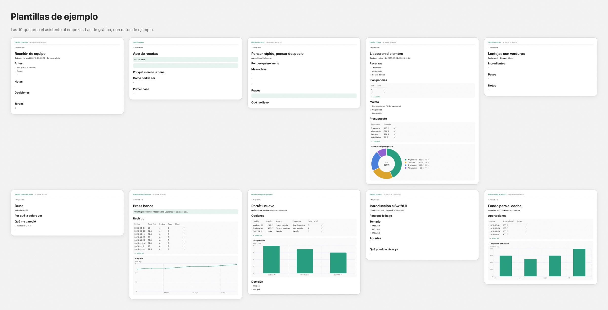

# VOTsidian

**Agenda personal para macOS sobre notas Markdown.** Tareas, hábitos, revisiones, notas, salud, dinero, casa, vehículo, viajes y lecturas en una sola app nativa. Todo se guarda como archivos `.md` en una carpeta tuya.

[](https://github.com/VictorOrts/VOTsidian/actions/workflows/test.yml)


- **Tus datos, en texto plano.** No hay base de datos ni formato propio. Cada pantalla lee y escribe notas Markdown que puedes abrir con cualquier editor.
- **Compatible con Obsidian.** Usa los mismos enlaces (`[[Nota]]`), propiedades YAML y tareas del plugin Tasks. Puedes usar las dos apps a la vez sobre la misma carpeta.
- **Privada.** No hay cuentas, servidores ni analítica, y la app no hace peticiones de red. La sincronización de las notas, si la quieres, la pone iCloud Drive o la carpeta que elijas. Solo pide acceso a Calendarios si activas la sincronización con Calendar, y entonces solo toca su propio calendario.
- **Modular.** Activa solo lo que vas a usar. Cada módulo crea su nota con un formato documentado en la [guía](GUIA.md).



## Contenido

- [Requisitos](#requisitos)
- [Instalación](#instalación)
- [Primeros pasos](#primeros-pasos)
- [Funciones](#funciones)
- [Módulos](#módulos)
- [Atajos de teclado](#atajos-de-teclado)
- [Tus datos](#tus-datos)
- [Desarrollo](#desarrollo)

## Requisitos

- macOS 26 o posterior.
- Para compilar: Xcode 26.6 o las herramientas de línea de comandos con Swift 6.3.

## Instalación

**Desde una release.** Cuando haya versiones publicadas, descarga el `.dmg` de [Releases](https://github.com/VictorOrts/VOTsidian/releases) y arrastra la app a Aplicaciones. Si esa versión no está notarizada, la primera vez ábrela con clic derecho → Abrir.

**Desde el código.**

```bash
git clone https://github.com/VictorOrts/VOTsidian.git
cd VOTsidian
./scripts/build-app.sh       # crea build/VOTsidian.app
open build/VOTsidian.app
```

Para probar sin empaquetar, `swift run VOTsidian`. Las notificaciones de macOS solo funcionan en la app empaquetada.

## Primeros pasos

1. Al abrir la app por primera vez sale el asistente **Empecemos**.
2. Elige la carpeta de notas: por defecto `iCloud Drive/VOTsidian`, o una que ya tengas, como tu vault de Obsidian.
3. Marca los módulos que quieres. La app crea una nota por módulo y no toca las que ya existen.

Los módulos que lleguen en una actualización quedan ocultos en una carpeta ya configurada, y la app avisa: los activas cuando quieras en **Ajustes → Módulos**.

Todo se cambia después en **Ajustes → Módulos**. La [guía](GUIA.md) explica el formato de cada nota, por si prefieres escribirlas a mano.

## Funciones

### Organización

| Función | Qué hace |
|---|---|
| **Inicio** | Lo que pide atención, lo de hoy y una tarjeta por módulo. «Personalizar» reordena y oculta las tarjetas. |
| **Tareas** | Fecha, prioridad y repetición («cada mes», «cada 2 semanas»), escritas en lenguaje natural: «llamar al dentista el viernes». |
| **Planificar semana** | Tablero de lunes a domingo para repartir las tareas arrastrándolas. |
| **Calendario** | Tareas, citas, pagos, cumpleaños, caducidades y vencimientos, con la nota del día, el ánimo y el sueño. |
| **Revisiones** | Semanal (hábitos, cumplimiento y racha), mensual y «Cerrar el día» para repasar lo pendiente y preparar mañana. |
| **Proyectos y Objetivos** | Lista o tablero, tareas por proyecto y revisión trimestral. |
| **Captura rápida** (⇧⌘N) | Tarea, gasto, peso, toma de medicación o idea, desde cualquier pantalla. |
| **Barra de menús** | Tareas, hábitos y tomas de hoy, ánimo y añadir tareas sin abrir la ventana. |
| **Avisos** | Lista por urgencia con botón para resolver cada aviso. También en un calendario propio «VOTsidian» de Calendar que la app mantiene al día sola (opcional y sin duplicados), como archivo `.ics` o como notificaciones de macOS. |

### Notas

| Función | Qué hace |
|---|---|
| **Editor** | Pestañas, guardado automático, sugerencias al escribir `[[` y `#`, notas fijadas y exportación a PDF. Si la nota cambia fuera de la app mientras la editas, avisa en vez de pisarla. |
| **Enlaces e incrustados** | `![[Nota]]`, `![[Nota#Sección]]` y `![[foto.png]]`. «Enlazada desde» muestra la línea que enlaza, con vista previa. |
| **Plantillas** | 10 de ejemplo (Reunión, Idea, Lectura, Viaje, Receta, Película o serie, Entrenamiento, Comparar opciones, Curso y Meta de ahorro). Pueden hacer preguntas al crear la nota y sugerir carpeta. |
| **Gráficas** | Un bloque `grafica` dibuja una tabla de la nota en línea, barras, área, puntos o tarta. |
| **Búsqueda** (⌘K) | Notas, tareas y pantallas, con sinónimos y filtros (`#etiqueta`, `carpeta:casa`, `tipo:evento`, «el viernes»). |
| **Órdenes rápidas** (⌘K) | `peso 105,5`, `ánimo 4`, `dormí 7,5`, `pinchazo hoy`, `tarea … el viernes`, `cita dentista el 29/10`, `cintura 98`, `compra leche y pan`, `libro Dune - Frank Herbert`, `terminé Dune`, `cuota Coche`. |
| **Bases, Grafo y Enlaces rotos** | Tabla de propiedades por tipo de nota con vistas guardadas, mapa de enlaces y sugerencias para arreglar enlaces que no llevan a nada. |

## Módulos

Cada módulo es opcional y se activa o desactiva en **Ajustes → Módulos**. Los ocultos no muestran pantallas, tarjetas, avisos ni eventos en el calendario.

| Módulo | Lo principal |
|---|---|
| **Peso y medidas** | Tendencia suavizada, ritmo de 4 y 2 meses, fecha estimada de llegada al objetivo (para bajar o para subir), hitos, medidas corporales, fotos de progreso y correlaciones con hábitos, ánimo y sueño. |
| **Plan nutricional** | Calorías y macros diarios y reparto por comidas. |
| **Medicación** | Varios medicamentos a la vez: pastillas diarias con una casilla por toma, inyecciones cada N días con la zona alternada y tomas cuando hace falta. Avisos por medicamento y hora y cumplimiento de 30 días. |
| **Salud y médicos** | Próximas citas, tratamientos, análisis en PDF, notas de cada visita y un resumen para llevar a la consulta. |
| **Finanzas y gastos** | Presupuesto mensual por partidas. Los gastos se apuntan como frase («22 € cena con Ana») y la app adivina la partida y aprende de tus correcciones. «Puedes gastar hoy», ritmo del mes, pagos fijos con aviso, fondo de emergencia, eventos y aportaciones, y resumen del año comparado con el anterior. |
| **Suscripciones** | Qué se renueva y cuándo, avisos antes del cobro y de que acabe una prueba gratuita, coste al mes y al año. Cada cobro se puede apuntar en Gastos. |
| **Préstamos y deudas** | Lo que debes, la cuota de cada mes, cuántas quedan y cuándo acabas. Apuntar una cuota baja lo que debes y, si quieres, la añade a Gastos. |
| **Casa** | Reformas y compras en lista o tablero, electrodomésticos con garantía y mantenimiento sugerido según tus aparatos. |
| **Lista de la compra** | Lista por secciones con casillas, también desde ⌘K. |
| **Ropa** | Lo que quieres comprar, con precio, prioridad y estado. |
| **Mascota** | Ficha, visitas y vacunas con aviso de la próxima. |
| **Vehículo** | ITV, seguro e impuesto con aviso 30 días antes, mantenimiento cada tantos km o meses, repostajes, consumo medio y gasto del año. El gasto se puede apuntar también en Gastos. |
| **Viajes** | Fechas, presupuesto y gastos de cada viaje (también en Gastos si quieres), lista de equipaje que se reutiliza y aviso si el pasaporte de Documentos caduca poco después de salir. |
| **Lecturas** | Libros pendientes, leyendo y terminados con nota de 1 a 5, objetivo anual y ritmo de lectura. |
| **Personas** | Cumpleaños y última vez que hablasteis. |
| **Documentos** | Caducidades de DNI, pasaporte, seguros… con aviso 30 días antes. Solo la referencia, nunca el documento. |
| **Objetivos** | Objetivos por área y revisión trimestral. |

## Atajos de teclado

| Atajo | Acción |
|---|---|
| ⌘K | Buscar y órdenes rápidas |
| ⇧⌘N | Captura rápida |
| ⌘1 … ⌘9 | Ir a las nueve primeras pantallas visibles (menú «Ir a») |
| ⌘S | Guardar la nota o la revisión |
| ⌥⌘Z | Deshacer el último cambio de la app |
| ⌘T / ⌘W | Nueva pestaña / cerrar pestaña en Notas |

## Tus datos

- **Copias automáticas.** Antes del primer cambio de cada día se copia la carpeta entera. Se guardan las últimas 14, fuera de iCloud, y se pueden cifrar con una contraseña guardada en el Llavero. La app avisa si una copia falla o la última es antigua.
- **Deshacer.** Cualquier cambio hecho desde la app se deshace con ⌥⌘Z, también los que tocan varias notas a la vez.
- **Recuperar.** El historial de una nota restaura versiones anteriores. También se puede restaurar una copia entera; antes, la app guarda el estado actual.
- **iCloud.** Avisa de notas duplicadas por conflicto y de archivos que aún no se han descargado.
- **Exportar.** Resumen del año en PDF, datos en CSV (un archivo por módulo, incluidos vehículo, suscripciones, préstamos, viajes y lecturas) y todas las notas en `.zip`.

## Desarrollo

Paquete de Swift sin dependencias externas: SwiftUI, Swift Charts y AppKit.

```text
Sources/VOTsidian/    app: modelos y lectura de notas (Parse, Edit), Store y una vista por pantalla
Tests/VOTsidianTests/ tests con Swift Testing sobre carpetas temporales
scripts/              build-app.sh (empaqueta y firma) y make-icon.swift (genera el icono)
```

```bash
swift test                                                            # todos los tests
VAULT_COPY=/ruta/a/tus/notas swift test                               # además, sobre una copia de tus notas
VOT_SHOTS=/carpeta VAULT_COPY=/ruta swift test --filter screenshots   # capturas de cada pantalla, en claro y oscuro
VOT_FUZZ=20 VOT_FUZZ_SEED=3 swift test --filter FuzzTests             # fuzz a fondo: 20 veces más casos y otra semilla
```

Los tests nunca tocan tus notas: trabajan sobre copias temporales. Además de los tests por función, hay un fuzz con semilla fija: notas deformadas (tablas rotas, cifras absurdas, dígitos de otros alfabetos, emojis compuestos, bytes inválidos) pasan por todos los lectores y editores y por todas las pantallas, y cada operación de la app se deshace y se repite comprobando la carpeta byte a byte.

**Firma.** `build-app.sh` firma con el primer certificado «Apple Development» del llavero, o ad hoc si no hay ninguno. Para distribuir, `SIGN_ID="Developer ID Application: …" ./scripts/build-app.sh` firma con runtime endurecido, sello de tiempo y el permiso de Calendarios ([VOTsidian.entitlements](scripts/VOTsidian.entitlements)), listo para notarizar.

**Integración continua.** Cada push y cada pull request pasan los tests y empaquetan la app ([test.yml](.github/workflows/test.yml)).

**Publicar una versión.** `git tag v1.2 && git push origin v1.2`. GitHub pasa los tests, crea `VOTsidian-1.2.dmg` y lo adjunta a una release ([release.yml](.github/workflows/release.yml)). Si el repositorio tiene los secretos de firma y notarización que lista ese archivo, el `.dmg` sale firmado y notarizado.
